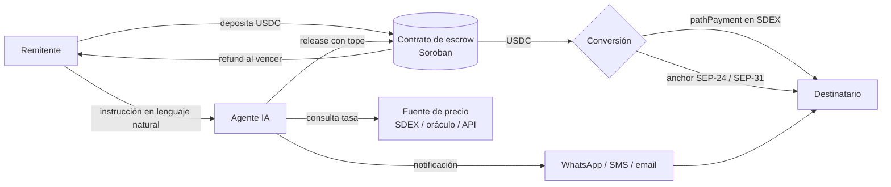
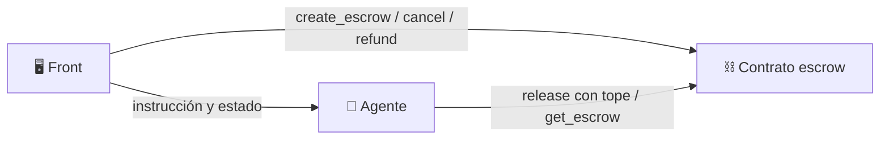

# remesa-agent

> Agente de IA que elige el mejor momento para enviar remesas en USDC a Colombia, con escrow en Stellar.

<!-- Badges: build, licencia, red (testnet/mainnet), demo -->
`Stellar` · `Soroban` · `USDC` · `Hackathon 2026`

---

## Tabla de contenido

1. [El problema](#-el-problema)
2. [La solución](#-la-solución)
3. [Usuario objetivo](#-usuario-objetivo)
4. [Cómo funciona](#-cómo-funciona)
5. [Arquitectura](#-arquitectura)
6. [Qué hace Stellar](#-qué-hace-stellar)
7. [Lógica de decisión del agente](#-lógica-de-decisión-del-agente)
8. [Seguridad y límites del agente](#-seguridad-y-límites-del-agente)
9. [Contrato de escrow](#-contrato-de-escrow)
10. [Stack técnico](#-stack-técnico)
11. [Estructura del repositorio](#-estructura-del-repositorio)
12. [Instalación y ejecución](#-instalación-y-ejecución)
13. [Demo](#-demo)
14. [Por qué encaja en la hackathon](#-por-qué-encaja-en-la-hackathon)
15. [Roadmap](#-roadmap)
16. [Equipo](#-equipo)
17. [Licencia](#-licencia)

---

## 🧩 El problema

Quien envía dinero a su familia en Colombia suele mandarlo **el día que recibe su sueldo**, sin saber si la tasa de cambio de ese día es buena o mala, y además **paga comisiones altas**.

Del otro lado, el destinatario **no sabe cuándo llegará el dinero ni cuánto recibirá** en pesos.

<!-- TODO: añadir 1–2 cifras de contexto (volumen de remesas a Colombia, comisión promedio) con su fuente -->

## 💡 La solución

Un agente al que el remitente le da una instrucción en lenguaje natural:

> «Envía **100 USDC** a mi mamá **este mes**, pero busca una **tasa razonable**.»

El agente:

1. **Vigila** la tasa USD → COP.
2. **Elige el momento** de envío según los límites que definió el usuario.
3. **Ejecuta** el envío a través de un contrato de escrow en Stellar, sin poder pasar del monto autorizado.
4. **Avisa al destinatario** con un mensaje claro: cuánto llega, cuándo y cómo retirarlo.

## 👤 Usuario objetivo

| | Remitente | Destinatario |
|---|---|---|
| **Quién** | Migrante colombiano en EE. UU. o España | Familiar en Colombia (p. ej., la mamá) |
| **Frecuencia** | Envía cada mes | Recibe cada mes |
| **Dolor** | No sabe si la tasa es buena; paga comisiones altas | No sabe cuándo ni cuánto recibirá |
| **Lo que gana** | Mejor tasa, menos comisión, cero vigilancia manual | Certeza y aviso claro |

<!-- TODO: persona concreta, p. ej. "Laura, 32 años, trabaja en Madrid y envía 150 € al mes a Medellín" -->

## ⚙️ Cómo funciona

```
1. Instrucción   →  El remitente define monto, destinatario, plazo y tasa mínima aceptable.
2. Depósito      →  Los USDC se bloquean en el contrato de escrow con un tope y una fecha de vencimiento.
3. Vigilancia    →  El agente consulta la tasa USDC → COP periódicamente.
4. Decisión      →  Cuando se cumple la política (tasa objetivo, tendencia o fin del plazo), decide enviar.
5. Ejecución     →  Llama a la función con tope del contrato; los fondos se convierten y liberan al destinatario.
6. Aviso         →  El destinatario recibe un mensaje con el monto en pesos y cómo retirarlo.
7. Reembolso     →  Si vence el plazo sin envío, el remitente recupera sus USDC.
```

## 🏗️ Arquitectura



<!-- TODO: reemplazar por imagen exportada si se prefiere un diagrama más visual -->

## ⭐ Qué hace Stellar

| Pieza | Rol |
|---|---|
| **Contrato de escrow (Soroban)** | Guarda los USDC y los entrega **solo al destinatario**, o los **devuelve al remitente** si vence el plazo. |
| **Función con tope de monto** | El agente solo puede llamar a una función limitada: **no puede gastar más de lo autorizado** ni enviar a otra cuenta. |
| **USDC en Stellar** | Activo estable para el envío, con liquidación en segundos y comisiones mínimas. |
| **pathPayment en SDEX** | Convierte USDC al activo de destino en una sola operación, con un mínimo de recepción garantizado. |
| **Anchor (SEP-24 / SEP-31)** | Rampa de salida a pesos colombianos (cuenta bancaria o retiro en efectivo). |

<!-- TODO: indicar qué anchor / activo COP se usa en testnet para la demo -->

## 🧠 Lógica de decisión del agente

Parámetros que define el usuario:

| Parámetro | Ejemplo | Descripción |
|---|---|---|
| `amount` | `100 USDC` | Monto máximo a enviar |
| `recipient` | `mamá` → `G...` | Dirección Stellar del destinatario |
| `deadline` | `30 de noviembre` | Fecha límite para enviar |
| `min_rate` | `4.000 COP/USD` | Tasa mínima aceptable |
| `target_rate` | `4.150 COP/USD` | Tasa a la que envía de inmediato |

Política propuesta (simple y explicable):

1. Si la tasa ≥ `target_rate` → **enviar ya**.
2. Si la tasa ≥ `min_rate` y está por encima del promedio de los últimos *N* días → **enviar**.
3. Si faltan menos de *X* días para el `deadline` y la tasa ≥ `min_rate` → **enviar**.
4. Si llega el `deadline` y la tasa < `min_rate` → **no enviar** y avisar al remitente (o reembolso).

Cada decisión queda registrada con su **justificación** para que el usuario entienda por qué el agente actuó.

<!-- TODO: definir N, X, frecuencia de consulta y fuente de precio -->

## 🔒 Seguridad y límites del agente

- El agente **nunca custodia** los fondos: están en el contrato de escrow.
- Solo puede invocar `release` con **monto ≤ tope** y **destinatario fijo**.
- El remitente puede **cancelar** antes del envío.
- Reembolso **automático** al vencer el plazo.
- Llaves del agente separadas de las del usuario, con permisos mínimos.
- Protección de deslizamiento en la conversión (`destMin` en pathPayment).

## 📜 Contrato de escrow

| Función | Quién la llama | Qué hace |
|---|---|---|
| `create_escrow(sender, recipient, amount, deadline, agent)` | Remitente | Deposita USDC y fija las reglas |
| `release(escrow_id, amount)` | Agente | Libera al destinatario, con `amount ≤ tope` |
| `refund(escrow_id)` | Remitente / cualquiera tras vencer | Devuelve los USDC al remitente |
| `cancel(escrow_id)` | Remitente | Cancela antes del envío |
| `get_escrow(escrow_id)` | Cualquiera | Consulta estado |

<!-- TODO: dirección del contrato desplegado en testnet -->
**Contrato en testnet:** `C...`

## 🛠️ Stack técnico

<!-- TODO: confirmar -->
- **Contrato:** Rust + Soroban SDK
- **Agente:** TypeScript (o Python) + LLM con herramientas (tool calling)
- **Stellar:** `@stellar/stellar-sdk` / `stellar-sdk`, Horizon, Soroban RPC
- **Notificaciones:** <!-- WhatsApp / Telegram / SMS / email -->
- **Front:** <!-- Next.js + Freighter -->

## 📁 Estructura del repositorio

El proyecto está dividido en tres áreas, una por persona del equipo. Cada carpeta tiene su propio README con tareas e interfaces.

```
remesa-agent/
├── blockchain/            # ⛓️ Stellar: contrato de escrow (Soroban) y scripts de testnet
│   ├── contracts/escrow/
│   └── scripts/
├── agent/                 # 🧠 Agente: tasa, decisión, ejecución y aviso
│   ├── src/
│   │   ├── policy/        # Lógica de decisión (cuándo enviar)
│   │   ├── price/         # Fuentes de tasa USDC → COP
│   │   ├── stellar/       # Llamadas al contrato y pathPayment
│   │   └── notify/        # Mensajes al destinatario
│   └── tests/
├── front/                 # 🖥️ Interfaz del remitente y vista del destinatario
│   └── src/
├── docs/                  # Diagramas y notas
├── .env.example
└── README.md
```

| Área | Carpeta | Entrega a los demás |
|---|---|---|
| ⛓️ Blockchain | [`blockchain/`](blockchain/README.md) | `ESCROW_CONTRACT_ID` y funciones del contrato |
| 🧠 Agente | [`agent/`](agent/README.md) | API de estado, tasa y decisiones |
| 🖥️ Front | [`front/`](front/README.md) | Experiencia del remitente y del destinatario |



## 🚀 Instalación y ejecución

### Requisitos

- <!-- Rust + target wasm32, Stellar CLI, Node.js / Python -->
- Cuenta en **testnet** con fondos de Friendbot y trustline a USDC

### Variables de entorno

```bash
STELLAR_NETWORK=testnet
SOROBAN_RPC_URL=
HORIZON_URL=
ESCROW_CONTRACT_ID=
AGENT_SECRET_KEY=        # nunca subir al repo
LLM_API_KEY=
NOTIFY_PROVIDER_KEY=
```

### Pasos

```bash
# 1. Compilar y desplegar el contrato
# TODO

# 2. Instalar y correr el agente
# TODO

# 3. Crear un escrow de prueba
# TODO
```

## 🎬 Demo

<!-- TODO: video o GIF de 1–2 minutos y enlace a la demo en vivo -->

Guion sugerido:

1. El remitente escribe: «Envía 100 USDC a mi mamá este mes, busca una tasa razonable».
2. Se crea el escrow (se ve en Stellar Expert).
3. El agente muestra la tasa actual y su decisión de esperar.
4. Se simula una mejora de tasa → el agente ejecuta el envío.
5. La mamá recibe el mensaje con el monto en pesos.
6. (Extra) Caso de vencimiento → reembolso automático.

## 🗺️ Roadmap

- [ ] Contrato de escrow con tope y vencimiento
- [ ] Agente con política básica de decisión
- [ ] Conversión con pathPayment en testnet
- [ ] Notificación al destinatario
- [ ] Integración con anchor real (SEP-24 / SEP-31)
- [ ] Remesas recurrentes mensuales
- [ ] Soporte EUR → COP (remitentes en España)
- [ ] Predicción de tasa con más señales

## 👥 Equipo

| Nombre | Área | Responsabilidad | Contacto |
|---|---|---|---|
| <!-- --> | ⛓️ Blockchain (Stellar) | Contrato de escrow, despliegue en testnet, pathPayment / anchor | <!-- --> |
| <!-- --> | 🧠 Agente | Tasa, política de decisión, ejecución y notificaciones | <!-- --> |
| <!-- --> | 🖥️ Front | Wallet, creación del escrow, seguimiento y vista del destinatario | <!-- --> |

## 📄 Licencia

[MIT](LICENSE)
